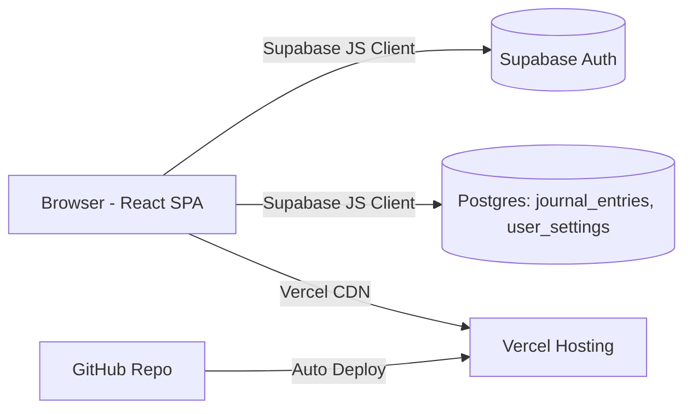
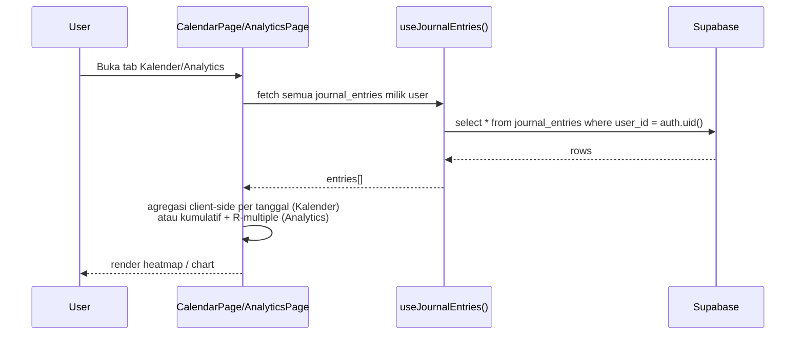

# Trading Compass — Technical Design Document

**Versi:** 1.7 — spesifikasi animasi §5.6 (Masuk ↔ Daftar, layar loading setelah masuk, transisi ganti tema; disetujui 9 Okt 2026), token panel ungu §5.1, baris Login §5.3; melengkapi v1.6 (mockup lengkap Claude Design jadi sumber visual utama, token Tag/modal/tombol hapus ditambah dan dikoreksi hasil audit kontras §5.1, sel kalender HP 44 px §5.3), v1.5 (tipografi IBM Plex Sans §5.2), v1.4 (glass-lite, responsif HP/tablet, token warna hasil audit kontras ulang §5.1, layout per breakpoint §5.3, efek kaca §5.5) dan v1.3 (header keamanan).
**Pasangan dokumen:** `trading-compass-requirements.md`
**Catatan:** Dokumen ini tool-agnostic — dipakai sebagai referensi/prompt awal untuk agent AI apa pun (Antigravity, dll.), bukan format spesifik satu tool.

---

## 1. Ringkasan Arsitektur

Single Page Application (SPA) React yang berkomunikasi langsung ke Supabase (Postgres + Auth + RLS) dari sisi client — tanpa backend server terpisah, sama seperti pola aplikasi lama, hanya kali ini terstruktur sebagai proyek multi-file yang proper alih-alih satu file HTML.



## 2. Tech Stack & Alasan Pemilihan

| Layer | Pilihan | Alasan |
|---|---|---|
| Framework | **React** (versi bawaan template Vite saat scaffold — jangan di-downgrade) | Sesuai keputusan Anda |
| Build tool | **Vite** ✅ dikonfirmasi | Standar modern untuk SPA React baru, setup minim, cepat, kompatibel dengan Vercel tanpa konfigurasi tambahan |
| Styling | **Tailwind CSS v4** ✅ dikonfirmasi | Konfigurasi CSS-first (bukan `tailwind.config.js` ala v3) — plugin `@tailwindcss/vite` di `vite.config.js`, token warna (violet, sage, brick, dll.) didefinisikan lewat `@theme { }` di `tokens.css`, dark mode lewat `@custom-variant dark` + toggle class `.dark` di `<html>` |
| Charting | **Recharts** ✅ dikonfirmasi | Library chart React paling umum & ringan, cocok untuk equity curve (LineChart) dan distribusi R:R (BarChart) |
| Icon | **lucide-react** ✅ dikonfirmasi | Ringan, gaya garis tipis yang cocok untuk tampilan data-app profesional, simple & fungsional |
| Routing | **react-router-dom** (default saya; boleh dicoret saat review plan) | Sidebar 5 halaman perlu URL per halaman + tombol Back browser berfungsi. Wajib `vercel.json` rewrite ke `index.html` agar refresh di URL non-root tidak 404 |
| Unit test | **Vitest** (devDependency) | Untuk menguji `riskCalculations.js` & `analyticsCalculations.js` (regression formula kalkulator); jalan native di Vite |
| Backend | **Supabase** (project baru) via `@supabase/supabase-js` | Sesuai keputusan Anda — Auth + Postgres + RLS. Client memakai **publishable key** (`sb_publishable_...`), bukan key `anon` lama |
| Hosting | **Vercel** | Sesuai keputusan Anda, auto-deploy dari GitHub |
| State management | **React Context + custom hooks** | Skala aplikasi kecil–menengah, Redux/Zustand berlebihan untuk kebutuhan ini |

## 3. Struktur Folder Proyek

```
trading-compass/
├─ src/
│  ├─ components/
│  │  ├─ ui/              # Button, Card, Tag, Modal, StatCard, RingGauge, EmptyState
│  │  └─ layout/          # AppShell, SidebarNav, TopBar, ThemeToggle, LangToggle, BootGate (layar loading §5.6 B)
│  ├─ pages/
│  │  ├─ AuthPage.jsx
│  │  ├─ DashboardPage.jsx
│  │  ├─ CalculatorPage.jsx
│  │  ├─ JournalPage.jsx
│  │  ├─ CalendarPage.jsx     # BARU
│  │  └─ AnalyticsPage.jsx    # BARU
│  ├─ context/
│  │  ├─ AuthContext.jsx
│  │  ├─ ThemeContext.jsx
│  │  ├─ LanguageContext.jsx
│  │  └─ JournalContext.jsx     # data jurnal dimuat sekali, dipakai bersama Jurnal/Dashboard/Kalender/Analytics
│  ├─ hooks/
│  │  ├─ useJournalEntries.js
│  │  ├─ useUserSettings.js
│  │  └─ useMediaQuery.js      # §5.6 A
│  ├─ lib/
│  │  ├─ supabaseClient.js
│  │  ├─ riskCalculations.js   # murni fungsi kalkulasi, terpisah dari UI → mudah di-unit-test
│  │  ├─ analyticsCalculations.js
│  │  ├─ bootTiming.js         # §5.6 B, murni + tes
│  │  ├─ themeTransition.js    # §5.6 C, murni + tes
│  │  └─ i18n.js
│  ├─ styles/
│  │  ├─ tokens.css        # :root/.dark (nilai per tema) + @theme { ... } — token warna & tipografi
│  │  └─ motion.css        # §5.6 animasi
│  ├─ index.css            # @import "tailwindcss"; @import "./styles/tokens.css"; @custom-variant dark(...)
│  ├─ App.jsx
│  └─ main.jsx
├─ public/
├─ .env.example
├─ package.json
└─ vite.config.js
```

## 4. Skema Data (Supabase — Project Baru)

### 4.1 Tabel `journal_entries`

```sql
create table journal_entries (
  id bigint generated always as identity primary key,
  user_id uuid not null references auth.users(id) on delete cascade,
  trade_date date not null,                          -- FIX: dulu string toLocaleDateString, sekarang tipe date asli
  instrument text not null,                           -- dulu 'instrumen'
  direction text not null check (direction in ('buy','sell')),  -- dulu 'arah'
  entry_price numeric,
  sl_price numeric,
  exit_price numeric,
  pnl numeric not null,
  status text not null check (status in ('plan','revenge')),
  note text,
  created_at timestamptz not null default now()
);

alter table journal_entries enable row level security;

create policy "journal_entries_owner_access"
  on journal_entries for all
  using (auth.uid() = user_id)
  with check (auth.uid() = user_id);

create index idx_journal_entries_user_date on journal_entries (user_id, trade_date);
```

### 4.2 Tabel `user_settings`

```sql
create table user_settings (
  user_id uuid primary key references auth.users(id) on delete cascade,
  display_name text default 'Trader',
  balance numeric not null default 0,
  lang text not null default 'id' check (lang in ('id','en')),
  theme text not null default 'dark' check (theme in ('light','dark')),  -- kolom BARU
  updated_at timestamptz not null default now()
);

alter table user_settings enable row level security;

create policy "user_settings_owner_access"
  on user_settings for all
  using (auth.uid() = user_id)
  with check (auth.uid() = user_id);
```

> Kedua tabel & RLS ini menggantikan (bukan memperbaiki) tabel lama, karena Anda memulai dari Supabase project kosong.

## 5. Design Tokens

Inspirasi CoinMarketCap dipakai secukupnya — kejelasan tipografi dan disiplin warna status — bukan kepadatan visualnya, sesuai arah simple & fungsional. Identitas violet dari versi lama dipertahankan.

### 5.1 Warna — glass-lite (M9), lolos audit kontras WCAG AA

Sumber visual utama (sejak 9 Okt 2026): kanvas Claude Design **"Trading Compass: Mockup Lengkap v1"** — 33 artboard (desktop 1440, tablet 834, HP 390, autentikasi, status layar, papan komponen, dan 4 prototipe animasi §5.6) dengan font IBM Plex Sans dan token di tabel ini; file `tc.css` di kanvas itu berisi token yang sama, `anim.css` berisi CSS prototipe animasi. Figma "Trading Compass - Logo Concepts" halaman **Glass-lite Mockup v1** tetap valid untuk warna dan tata letak, tetapi masih memakai font lama (kuota MCP Figma paket Starter habis untuk Oktober 2026).

| Token | Gelap | Terang | Dipakai untuk |
|---|---|---|---|
| `--bg` | `#0e1119` | `#f4f2fb` | latar dasar halaman |
| `--bg-glow-1` | `rgba(145,121,214,.32)` | `rgba(145,121,214,.24)` | cahaya ungu (kiri atas) |
| `--bg-glow-2` | `rgba(76,111,214,.22)` | `rgba(99,132,255,.14)` | cahaya biru (kanan bawah) |
| `--bg-panel` | `rgba(22,29,37,.78)` | `rgba(255,255,255,.78)` | kartu (tanpa blur) |
| `--bg-panel-strong` | `rgba(22,29,37,.70)` | `rgba(255,255,255,.72)` | sidebar, top bar, tab bar, modal (dengan blur) |
| `--bg-panel-solid` | `#161d25` | `#ffffff` | fallback tanpa transparansi (§5.5) |
| `--bg-panel-raised` | `rgba(28,36,46,.90)` | `rgba(240,241,244,.90)` | input, chip, sel kalender kosong |
| `--line` | `rgba(255,255,255,.08)` | `rgba(21,24,35,.08)` | border kaca, pemisah |
| `--text-primary` | `#e9e4d8` | `#151823` | teks utama |
| `--text-secondary` | `#a9a89e` | `#565c6b` *(sebelumnya `#6b7280`)* | teks sekunder |
| `--accent` | `#9179d6` | `#9179d6` | logo, ring fokus, cahaya (bukan teks) |
| `--accent-text` | `#a996e3` *(sebelumnya `#9179d6`)* | `#6d55b8` | teks/tautan/ikon aksen |
| `--accent-solid` | `#6d55b8` | `#6d55b8` | latar tombol utama (teks putih) |
| `--accent-soft` | `rgba(145,121,214,.16)` | `rgba(145,121,214,.12)` | latar menu aktif, chip ikon |
| `--accent-border` | `rgba(145,121,214,.45)` | `rgba(109,85,184,.35)` | border menu aktif, input fokus |
| `--sage` (profit) | `#7fa387` | `#177245` | teks/angka profit |
| `--brick` (loss) | `#d9786a` | `#c4271c` *(sebelumnya `#d92d20`)* | teks/angka loss |
| `--sage-soft` / `--brick-soft` | sage / brick α .08 *(sebelumnya .16)* | `#177245` / `#c4271c` α .10 | latar Tag |
| `--sage-border` / `--brick-border` | sage / brick α .35 | `#177245` / `#c4271c` α .30 | garis tepi Tag status |
| `--on-danger` | `#0e1119` | `#ffffff` | teks di tombol hapus (latar `--brick`) |
| `--scrim` | `rgba(5,7,12,.62)` | `rgba(21,24,35,.30)` | lapisan gelap di belakang modal / bottom sheet |
| `--heat-profit-1..4` | `#7fa387` α .25 / .45 / .55 / .90 | `#1f9d55` α .18 / .36 / .56 / .80 | sel heatmap profit |
| `--heat-loss-1..4` | `#d9786a` α .25 / .45 / .55 / .90 | `#d92d20` α .16 / .32 / .50 / .72 | sel heatmap loss |
| `--text-on-heat-strong` | `#0e1119` | `#151823` | angka tanggal di sel level 4 |
| `--auth-panel-from` / `--auth-panel-to` | `#6d55b8` / `#4a3a8c` | sama | gradien panel ungu Masuk ↔ Daftar (§5.6 A), teks putih |

Aturan angka tanggal di heatmap: level 4 memakai `--text-on-heat-strong`, level lain memakai `--text-primary`.

**Audit kontras (kasus terburuk = teks di atas panel yang berada di titik cahaya paling terang):**
- Kartu (`--bg-panel`) di titik glow ungu — gelap: text-primary 12,92 · text-secondary 6,85 · sage 5,85 · brick 5,34; terang: text-primary 16,66 · text-secondary (`#565c6b`) 6,30 · accent-text 5,43 · sage 5,60 · brick (`#c4271c`) 5,41.
- Panel kuat (`--bg-panel-strong`) di titik glow — gelap: accent-text `#a996e3` 6,02 (warna lama `#9179d6` hanya 4,36, gagal); terang: accent-text 5,26.
- Menu aktif (`--accent-soft` di atas panel kuat di glow): gelap 4,84; terang 4,66.
- Teks langsung di latar gradien (judul halaman): gelap text-secondary 4,99; terang text-secondary 4,73 (warna lama `#6b7280` hanya 3,64, gagal).
- Teks putih di `--accent-solid`: 5,77.
- Angka tanggal heatmap — gelap: level 2 5,88 · level 3 (α .55, teks terang) 4,84 / 5,24 · level 4 (teks gelap) 5,74 / 5,25; terang: semua level ≥ 5,41.
- Logo tetap `#9179d6` dan `#5f4f96` (grafis, bukan teks).
- Tambahan audit 9 Okt 2026 (saat menyusun mockup lengkap): teks Tag di atas `--sage-soft`/`--brick-soft` α .16 (gelap) hanya 4,37 / 4,12 di titik glow, gagal; dengan α .08 menjadi 5,01 / 4,65. Tag "Sesuai rencana" (accent-text di accent-soft): gelap 4,97, terang 4,75. Tombol hapus: `#0e1119` di `#d9786a` 6,15; putih di `#c4271c` 5,75. Teks di modal (panel kuat di atas `--scrim`): terang text-secondary 5,56, brick 4,78, sage 4,94, accent-text 4,79. Segmented aktif: gelap 4,91, terang 4,56. Teks jumlah trade di sel heatmap memakai opasitas penuh (opasitas .85 turun ke 4,14 di sel loss level 3 tema gelap).
- Panel ungu Masuk ↔ Daftar (9 Okt 2026): teks putih penuh di gradien `#6d55b8` → `#4a3a8c` = 5,77 sampai 9,23. Teks putih α .88 hanya 4,89 dan turun ke 4,10 bila ada titik cahaya, jadi semua teks panel memakai putih penuh. Garis tombol putih α .70 = 3,73 (non-teks, syarat ≥ 3). Ornamen kompas putih α .08 tidak boleh berada di bawah teks (bila bertumpuk, kontras turun ke 4,66), karena itu diletakkan di tepi bawah panel.

**Implementasi di Tailwind v4:** token yang berbeda per tema didefinisikan di `:root` (terang, default) dan `.dark`, lalu dirujuk dari `@theme` (`--color-bg: var(--bg);` dst.) sehingga utility class (`bg-bg`, `text-text-primary`, `bg-bg-panel`) otomatis ikut berganti saat class `.dark` di-toggle.

### 5.2 Tipografi — IBM Plex Sans (disetujui 8 Okt 2026, dikerjakan di M9a)

Satu keluarga font untuk seluruh aplikasi: **IBM Plex Sans** (variable font, sumbu `wght` 100–700 dan `wdth` 75–100, lisensi SIL OFL 1.1). Menggantikan Space Grotesk + Inter + IBM Plex Mono.

Alasan pemilihan (dibandingkan dengan Archivo, Plus Jakarta Sans, dan Newsreader + Hanken Grotesk pada potongan Dashboard yang sama):
- Angka bawaan sudah sama lebar (tabular), jadi kolom P&L dan lot sejajar tanpa font mono.
- Huruf yang sering tertukar mudah dibedakan: `I` berkaki, `l` berekor, `1` berbendera; `0` lebih sempit dari `O`.
- Satu file font, bukan tiga: perkiraan ±49 KB vs ±79 KB (subset Latin, dihitung dari file sumber Google Fonts).

| Peran | Pengaturan | Dipakai di |
|---|---|---|
| Display | wght 600, `letter-spacing: -0.01em`, line-height 1,15 | judul halaman, judul kartu, wordmark |
| Body | wght 400 (penekanan 500 / 600), line-height 1,5 | teks UI, label, tombol (600) |
| Angka besar | wght 500, `tabular-nums` | saldo, P&L, stat card, hasil kalkulator |
| Angka tabel | wght 500, `font-stretch: 87.5%` (semi-condensed), `tabular-nums` | kolom lot, harga, P&L di tabel Jurnal dan daftar trade |

Skala ukuran (px): 12 dan 13 (label, keterangan), 14 (tabel, teks kecil), 15–16 (paragraf; input wajib ≥ 16 di bawah 768 px), 18 (judul kartu), 24 (angka stat), 30 (judul halaman ≥ 768 px; 24 di HP), 34 (angka saldo ≥ 768 px; 28 di HP). Paragraf catatan trade line-height 1,6. Label memakai huruf kalimat biasa, bukan huruf kapital semua.

Pemuatan lewat Google Fonts (sudah diizinkan CSP §8.1; tidak ada dependency npm baru), di `<head>` `index.html`:

```html
<link rel="preconnect" href="https://fonts.googleapis.com">
<link rel="preconnect" href="https://fonts.gstatic.com" crossorigin>
<link rel="stylesheet" href="https://fonts.googleapis.com/css2?family=IBM+Plex+Sans:wdth,wght@87.5..100,400..700&display=swap">
```

Token di `tokens.css` (`@theme`): `--font-sans: "IBM Plex Sans", system-ui, -apple-system, "Segoe UI", Roboto, sans-serif;` dan `--font-display: var(--font-sans);`. Token/utility untuk Space Grotesk, Inter, dan IBM Plex Mono dihapus; angka memakai utility `tabular-nums`. Pratinjau pembanding: kanvas "Pilihan Font Trading Compass", papan Opsi C.

### 5.3 Layout & responsif (M9)

Breakpoint mengikuti bawaan Tailwind: `md` = 768 px, `lg` = 1024 px, `xl` = 1280 px. Konten maks. 1400 px, padding halaman 16 px.

| Area | HP (< 768) | Tablet (768–1023) | Desktop (≥ 1024; kolom kanan Dashboard mulai ≥ 1280) |
|---|---|---|---|
| Navigasi | **Bottom tab bar** 5 menu, `position: fixed`, tinggi 64 px + `env(safe-area-inset-bottom)`; konten diberi padding bawah setara | **Sidebar ikon (rail)** 76 px; label lewat `aria-label` + tooltip; Keluar di bawah | **Sidebar penuh** 252 px; Keluar di bawah |
| Top bar | Logo + wordmark, tema, bahasa, avatar (menu: nama tampilan + Keluar) | Tambah Trade, saldo, avatar, tema, bahasa | Tagline, Tambah Trade, saldo, avatar + nama, tema, bahasa |
| Dashboard | Bertumpuk: judul → saldo → stat 2×2 → aksi cepat 2×2 → mini kalender → ringkasan bulan → trade terakhir | Saldo satu baris, stat 2×2 (`lg`: 4 kolom), aksi cepat 2×2 (`lg`: 4), kalender + trade terakhir berdampingan | `xl`: kolom utama + kolom kanan 320 px (saldo, trade terakhir) |
| Jurnal | **Daftar kartu** (`TradeCard`), tombol "Tambah" di header | Tabel di kartu kaca, kolom catatan disembunyikan, `overflow-x-auto` | Tabel penuh |
| Kalkulator | Form 1 kolom, hasil di bawah | Form 2 kolom, hasil di bawah | Form dan hasil berdampingan |
| Kalender | Sel tinggi 44 px (angka + warna; 44 px supaya memenuhi area sentuh FR-UI-5), ringkasan di atas grid | Grid penuh + ringkasan satu baris | Grid + ringkasan di samping |
| Analytics | Ring disiplin → equity → histogram, lebar penuh, tinggi chart 220 px | Ring + histogram berdampingan, equity lebar penuh | Tiga kartu |
| Modal (`<dialog>`) | Bottom sheet lebar penuh, maks. 90vh, tombol aksi menempel di bawah | Dialog di tengah, maks. 560 px | sama |
| Login / daftar | Kartu lebar penuh dikurangi 32 px, tab "Masuk" / "Daftar" (§5.6 A) | Kartu maks. 420 px di tengah, tab yang sama | ≥ 1024: kartu 960 × 560 px, dua form berdampingan + panel ungu geser (§5.6 A). Lupa password & `/reset-password` tetap kartu tunggal maks. 420 px |

Aturan umum: tidak ada scroll horizontal halaman di lebar 360 px; area sentuh ≥ 44×44 px; ukuran huruf input ≥ 16 px di bawah `md` (mencegah auto-zoom iOS); `<meta name="viewport" content="width=device-width, initial-scale=1, viewport-fit=cover">`. Drawer + tombol hamburger dari M2 dihapus.

### 5.4 Logo / Brand Mark (FINAL — disetujui)

Konsep "Needle Mark": bentuk kite/diamond dua-nada ungu (poros kompas), pojok kiri atas header, disandingkan wordmark "Trading Compass".

```html
<svg width="40" height="40" viewBox="0 0 48 48" xmlns="http://www.w3.org/2000/svg">
  <path d="M24 6 L34 24 L24 24 L14 24 Z" fill="#9179d6"/>
  <path d="M24 24 L34 24 L24 42 L14 24 Z" fill="#5f4f96"/>
  <circle cx="24" cy="24" r="3" fill="#5f4f96"/>
</svg>
```

- Warna: dua gradasi hue ungu yang sama (bukan pasangan warna kontras) — konsisten dengan `--accent` & `--accent-dim` di kedua tema.
- Komponen: `src/components/ui/BrandLogo.jsx` (ikon inline + teks wordmark, `fontFamily: var(--font-display)`), dipakai di `TopBar`/`SidebarNav`.
- Aset standalone: `trading-compass-logo-icon.svg` (favicon, app-icon, share preview).

### 5.5 Efek kaca & cahaya (glass-lite)

- **Latar:** `body::before { content:""; position:fixed; inset:0; z-index:-1; background: radial-gradient(60rem 40rem at -10% -15%, var(--bg-glow-1), transparent 70%), radial-gradient(50rem 36rem at 110% 105%, var(--bg-glow-2), transparent 70%), var(--bg); }`. Gradien CSS biasa, tanpa blur dan tanpa gambar, dan tanpa `background-attachment: fixed` (bermasalah di iOS).
- **Kartu:** utility `glass` = `background: var(--bg-panel); border: 1px solid var(--line);` radius 20 px. **Tanpa** `backdrop-filter`.
- **Panel kuat** (hanya sidebar, rail, top bar, bottom tab bar, modal): utility `glass-strong` = `background: var(--bg-panel-strong); border: 1px solid var(--line); backdrop-filter: blur(16px) saturate(140%)` (sertakan `-webkit-backdrop-filter`); di bawah `md` blur 12 px.
- **Fallback:** `@supports not (backdrop-filter: blur(1px))` dan `@media (prefers-reduced-transparency: reduce)` → latar panel memakai `--bg-panel-solid`, tanpa blur. `@media (prefers-reduced-motion: reduce)` → tanpa transisi.
- **Cahaya:** menu aktif dan tombol utama memakai `box-shadow: 0 0 18px rgba(145,121,214,.35)`. Logo memakai `drop-shadow` serupa.
- **Radius:** kartu 20 px, kontrol (tombol, input, chip) 12 px, pill 9999 px; sidebar 24 px, top bar 20 px.
- Semua efek di atas murni CSS, tidak memerlukan perubahan CSP.

### 5.6 Animasi (disetujui 9 Okt 2026 — FR-AUTH-8, FR-AUTH-9, FR-THEME-4)

**Prinsip**
- Hanya tiga momen yang dianimasikan: perpindahan Masuk ↔ Daftar, layar loading setelah masuk, dan ganti tema. Halaman lain tidak mendapat animasi baru.
- CSS murni dan API bawaan browser (View Transitions, `element.animate`), tanpa dependency baru. Yang dianimasikan `transform` dan `opacity`; pengecualian: `border-radius` panel ungu dan `clip-path` transisi tema (masing-masing hanya satu elemen).
- `prefers-reduced-motion: reduce` mematikan semuanya (FR-UI-6).
- Prototipe yang bisa diklik: kanvas mockup, halaman **Animasi (disetujui 9 Okt)** — `Anim-Masuk-Daftar`, `Anim-HP-Masuk-Daftar`, `Anim-Loading` (Tweaks `status`: memuat / lambat / gagal), `Anim-Ganti-Tema`; semuanya punya Tweak `motion: reduced`. CSS prototipe ada di `anim.css` kanvas itu. Kode di bawah adalah versi untuk aplikasi dengan nama token §5.1.
- File baru (lihat §3): `src/styles/motion.css` (di-import dari `index.css` setelah `tokens.css`), `src/lib/bootTiming.js`, `src/lib/themeTransition.js`, `src/hooks/useMediaQuery.js`, `src/components/layout/BootGate.jsx`. Tes Vitest untuk kedua file `lib` wajib (vektor B1–B10 dan T1–T6 di requirements), diletakkan mengikuti pola tes yang sudah ada. Token `--auth-panel-from` / `--auth-panel-to` ditaruh di `tokens.css` (`:root`, sama untuk kedua tema).

**Token gerak** (di `motion.css`: `:root { --dur-scene: 600ms; --dur-tab: 450ms; --ease-io: cubic-bezier(.65, 0, .35, 1); }`)

| Token | Nilai | Dipakai |
|---|---|---|
| `--dur-scene` | 600 ms | panel Masuk ↔ Daftar, transisi tema |
| `--dur-tab` | 450 ms | tab Masuk / Daftar < 1024 px |
| `--ease-io` | `cubic-bezier(.65, 0, .35, 1)` | semua gerak geser |
| fade isi | keluar 280 ms; masuk 300 ms setelah tunda 300 ms | form dan teks panel. Saat panel tepat di tengah, kedua sisi kosong sesaat — disengaja, sama seperti video acuan |
| layar loading | muncul dan hilang 240 ms; ayunan jarum 1,6 s (sekali); cahaya 2,4 s dan bar 1,3 s (berulang) | bagian B |

#### A. Perpindahan Masuk ↔ Daftar (FR-AUTH-8)

Render **satu** tata letak saja, dipilih dengan hook `useMediaQuery('(min-width: 1024px)')`: nilai awal `window.matchMedia?.(query)?.matches ?? false`, lalu berlangganan event `change`. Jangan render keduanya sekaligus, karena input dan `id` jadi dobel. State isian form disimpan di AuthPage supaya tidak hilang saat lebar layar melewati 1024 px. `mode` = `'login' | 'register'`, diambil dari mekanisme yang sudah ada (route atau state).

```jsx
// ≥ 1024 px
<div className="auth-split glass" data-mode={mode}>
  <section className="auth-pane auth-pane--login" inert={mode !== 'login'}>{/* form Masuk */}</section>
  <section className="auth-pane auth-pane--register" inert={mode !== 'register'}>{/* form Daftar */}</section>
  <div className="auth-overlay">
    <svg className="auth-overlay__dial" viewBox="0 0 320 320" fill="none" stroke="#fff" aria-hidden="true">
      <circle cx="160" cy="160" r="150" strokeWidth="2" />
      <circle cx="160" cy="160" r="118" strokeWidth="1.5" />
      <path d="M160 10v28M160 282v28M10 160h28M282 160h28" strokeWidth="3" strokeLinecap="round" />
      <path d="M160 64 L184 160 L160 160 L136 160 Z" fill="#fff" stroke="none" />
      <path d="M160 160 L184 160 L160 256 L136 160 Z" fill="#fff" stroke="none" opacity=".55" />
    </svg>
    <div className="auth-cta auth-cta--to-register" inert={mode !== 'login'}>
      <h2>Belum punya akun?</h2>
      <p>Buat akun untuk mulai mencatat trade, menghitung risiko sebelum entry, dan melihat pola trading Anda.</p>
      <button type="button" onClick={() => switchMode('register')}>Daftar</button>
    </div>
    <div className="auth-cta auth-cta--to-login" inert={mode !== 'register'}>
      <h2>Sudah punya akun?</h2>
      <p>Masuk untuk melanjutkan jurnal trading Anda.</p>
      <button type="button" onClick={() => switchMode('login')}>Masuk</button>
    </div>
  </div>
</div>

// < 1024 px
<section className="glass auth-card">
  <div className="auth-tabs" data-mode={mode} role="group" aria-label="Masuk atau daftar">
    <span className="auth-tabs__ind" aria-hidden="true" />
    <button type="button" aria-pressed={mode === 'login'} onClick={() => switchMode('login')}>Masuk</button>
    <button type="button" aria-pressed={mode === 'register'} onClick={() => switchMode('register')}>Daftar</button>
  </div>
  <div className="auth-track-wrap">
    <div className="auth-track" data-mode={mode}>
      <section className="auth-slide auth-slide--login" inert={mode !== 'login'}>{/* form Masuk */}</section>
      <section className="auth-slide auth-slide--register" inert={mode !== 'register'}>{/* form Daftar */}</section>
    </div>
  </div>
</section>
```

Catatan implementasi:
- `inert`: React 19 menerima `inert={true | false}`; React 18 perlu `inert={cond ? '' : undefined}`. Cek versi React di `package.json` sebelum menulis.
- Fokus: pindahkan hanya bila `mode` benar-benar berubah. Bandingkan dengan mode sebelumnya, bukan penanda "render pertama", karena `<StrictMode>` menjalankan effect dua kali saat mount:
  ```jsx
  const prevMode = useRef(mode);
  useEffect(() => {
    if (prevMode.current === mode) return;
    prevMode.current = mode;
    (mode === 'login' ? loginEmailRef : registerEmailRef).current?.focus({ preventScroll: true });
  }, [mode]);
  ```
  Saat halaman pertama dibuka, fokus tidak dipindah.
- Setelah daftar berhasil (FR-AUTH-6), isi pane/slide Daftar diganti konten "Cek email Anda" seperti papan Cek-Email di mockup (ikon, judul, teks berisi email, petunjuk folder spam, tombol "Kembali ke halaman masuk" yang memanggil `switchMode('login')`).
- Judul form (`h1`): "Selamat datang kembali" (Masuk) dan "Buat akun baru" (Daftar). Keduanya ada di DOM; yang tidak aktif berada di dalam elemen `inert`.
- Halaman: `min-height: 100dvh`, kartu di tengah dengan padding halaman 16 px di bawah 768 px dan 24 px mulai 768 px (§5.3). Jika tinggi layar kurang, halaman di-scroll; jangan `overflow: hidden` pada `body`.
- Tidak ada tombol login pihak ketiga.
- Teks baru masuk kamus ID/EN. EN: "Don't have an account?" · "Create an account to start logging trades, sizing risk before entry, and seeing your trading patterns." · "Already have an account?" · "Sign in to continue your trading journal." · "Welcome back" · "Create a new account" · "Sign in or sign up" (aria-label tab).

```css
/* motion.css — token gerak */
:root{--dur-scene:600ms;--dur-tab:450ms;--ease-io:cubic-bezier(.65,0,.35,1)}

/* A. Masuk ↔ Daftar, ≥ 1024 px */
.auth-split{position:relative;width:960px;max-width:100%;height:560px;border-radius:28px;overflow:hidden;box-shadow:0 24px 64px rgba(21,24,35,.18)}
.dark .auth-split{box-shadow:0 24px 64px rgba(0,0,0,.45)}
.auth-pane{position:absolute;top:0;bottom:0;width:50%;padding:48px 56px;display:flex;flex-direction:column;gap:16px;overflow-y:auto;
  transition:opacity 280ms ease,transform var(--dur-scene) var(--ease-io),visibility 0s linear 280ms}
/* tengah secara vertikal, tetapi bila isi lebih tinggi dari kartu (pesan error, teks EN) isi bisa di-scroll, tidak terpotong */
.auth-pane>:first-child{margin-top:auto}
.auth-pane>:last-child{margin-bottom:auto}
.auth-pane--login{left:0;transition:opacity 300ms ease 300ms,transform var(--dur-scene) var(--ease-io),visibility 0s}
.auth-pane--register{left:50%;opacity:0;visibility:hidden;transform:translateX(16px)}
.auth-split[data-mode="register"] .auth-pane--login{opacity:0;visibility:hidden;transform:translateX(-16px);
  transition:opacity 280ms ease,transform var(--dur-scene) var(--ease-io),visibility 0s linear 280ms}
.auth-split[data-mode="register"] .auth-pane--register{opacity:1;visibility:visible;transform:none;
  transition:opacity 300ms ease 300ms,transform var(--dur-scene) var(--ease-io),visibility 0s}

.auth-overlay{position:absolute;top:0;left:50%;width:50%;height:100%;z-index:2;overflow:hidden;color:#fff;
  background:linear-gradient(150deg,var(--auth-panel-from) 0%,var(--auth-panel-to) 100%);
  border-radius:160px 0 0 120px;box-shadow:-16px 0 48px rgba(10,8,30,.28);
  transition:transform var(--dur-scene) var(--ease-io),border-radius var(--dur-scene) var(--ease-io),box-shadow var(--dur-scene) var(--ease-io)}
.auth-split[data-mode="register"] .auth-overlay{transform:translateX(-100%);border-radius:0 160px 120px 0;box-shadow:16px 0 48px rgba(10,8,30,.28)}
.auth-overlay__dial{position:absolute;left:50%;bottom:-170px;width:320px;height:320px;margin-left:-160px;opacity:.08;pointer-events:none}
.auth-cta{position:absolute;inset:0;display:flex;flex-direction:column;align-items:center;justify-content:center;gap:14px;text-align:center;
  transition:opacity 280ms ease,transform var(--dur-scene) var(--ease-io),visibility 0s linear 280ms}
.auth-cta--to-register{padding:56px 56px 56px 96px;transition:opacity 300ms ease 300ms,transform var(--dur-scene) var(--ease-io),visibility 0s}
.auth-cta--to-login{padding:56px 96px 56px 56px;opacity:0;visibility:hidden;transform:translateX(-20%)}
.auth-split[data-mode="register"] .auth-cta--to-register{opacity:0;visibility:hidden;transform:translateX(20%);
  transition:opacity 280ms ease,transform var(--dur-scene) var(--ease-io),visibility 0s linear 280ms}
.auth-split[data-mode="register"] .auth-cta--to-login{opacity:1;visibility:visible;transform:none;
  transition:opacity 300ms ease 300ms,transform var(--dur-scene) var(--ease-io),visibility 0s}
.auth-cta h2{font-size:30px;font-weight:600;letter-spacing:-.01em;line-height:1.2}
.auth-cta p{font-size:15px;line-height:1.6;max-width:300px}
.auth-cta button{min-height:44px;min-width:168px;margin-top:10px;padding:0 24px;border-radius:12px;border:1.5px solid rgba(255,255,255,.7);
  background:transparent;color:#fff;font-size:15px;font-weight:600}
.auth-cta button:hover{background:rgba(255,255,255,.12)}
.auth-cta button:focus-visible{outline:2px solid #fff;outline-offset:3px}

/* A. Masuk ↔ Daftar, < 1024 px */
.auth-card{--auth-card-px:18px;display:flex;flex-direction:column;gap:20px;width:100%;max-width:420px;padding:18px var(--auth-card-px) 22px}
.auth-tabs{position:relative;display:grid;grid-template-columns:repeat(2,minmax(0,1fr));padding:3px;border-radius:12px;background:var(--bg-panel-raised);border:1px solid var(--line)}
.auth-tabs__ind{position:absolute;top:3px;bottom:3px;left:3px;width:calc(50% - 3px);border-radius:9px;background:var(--accent-soft);
  border:1px solid var(--accent-border);transition:transform var(--dur-tab) var(--ease-io)}
.auth-tabs[data-mode="register"] .auth-tabs__ind{transform:translateX(100%)}
.auth-tabs button{position:relative;z-index:1;min-height:44px;border:0;border-radius:9px;background:transparent;color:var(--text-secondary);
  font-size:15px;font-weight:600;transition:color 200ms ease}
.auth-tabs button[aria-pressed="true"]{color:var(--accent-text)}
.auth-track-wrap{overflow:hidden;margin-inline:calc(-1 * var(--auth-card-px))}
.auth-track{display:flex;width:200%;transition:transform var(--dur-tab) var(--ease-io)}
.auth-track[data-mode="register"]{transform:translateX(-50%)}
.auth-slide{width:50%;padding:4px var(--auth-card-px);display:flex;flex-direction:column;gap:16px;transition:opacity 300ms ease 100ms,visibility 0s}
.auth-track[data-mode="login"] .auth-slide--register,
.auth-track[data-mode="register"] .auth-slide--login{opacity:0;visibility:hidden;transition:opacity 200ms ease,visibility 0s linear var(--dur-tab)}
```

Uji manual A:
- **A1** (≥ 1024 px) Klik "Daftar" di panel ungu → panel bergeser ke kiri ±0,6 detik, form Daftar muncul di kanan, kursor di field Email Daftar.
- **A2** Klik "Masuk" di panel → kembali; kursor di field Email Masuk.
- **A3** Tekan Tab berulang kali di mode Masuk → fokus tidak pernah masuk ke form Daftar yang tertutup (dan sebaliknya).
- **A4** (lebar 390 px dan 834 px) Tekan tab "Daftar" → indikator dan form bergeser ±0,45 detik; tidak ada scroll horizontal.
- **A5** Reduced motion (DevTools → More tools → Rendering → *Emulate CSS media feature prefers-reduced-motion: reduce*) → berpindah seketika.
- **A6** Login salah → pesan error sama seperti sekarang dan tidak ada layar loading. Daftar berhasil → pesan "cek email" tampil di sisi Daftar.
- **A7** "Lupa password?" dan `/reset-password` → kartu tunggal seperti sebelumnya.
- **A8** Jendela 1366 × 768 → kartu utuh dan halaman bisa di-scroll.
- **A9** Ganti bahasa ke EN → semua teks baru berganti.

#### B. Layar loading setelah masuk (FR-AUTH-9)

Alur:
1. Form Masuk: setelah `signInWithPassword` berhasil, set `bootReason = 'login'` dan `bootStart = performance.now()` di AuthContext. Nilai bawaan `bootReason` adalah `'restore'`.
2. `BootGate` dipasang di layout terproteksi dan membungkus `AppShell`. Waktu mulai = `bootStart` (login) atau `performance.now()` saat `BootGate` dipasang (pulih). Fase pertama dihitung langsung saat mount, lalu diulang setiap 100 ms dengan `getBootPhase` (vektor B1–B10 di requirements FR-AUTH-9), sampai hasilnya `done`.
3. Empat tanda siap: sesi; `user_settings` sudah di-upsert dan dibaca (§6.3); pemuatan pertama `JournalContext` selesai; chunk halaman tujuan sudah dimuat (setelah login = Dashboard, saat pulih = halaman di URL). Preload chunk dengan memanggil fungsi `import()` yang sama dengan yang dipakai `React.lazy`, supaya tidak diunduh dua kali. `readyAt` = saat keempatnya pertama kali terpenuhi.
4. Wrapper `AppShell`: `visibility: hidden` selama fase `hidden`; `inert` selama layar loading tampil sampai fade-out dimulai. `AppShell` tetap dirender, jadi halaman sudah lengkap saat layar loading memudar.
5. Saat `done` dan layar loading sedang tampil: set `leaving` (atribut `data-leaving`), biarkan layar loading terpasang 240 ms dengan `setTimeout` (0 ms bila reduced motion; jangan menunggu `transitionend`, karena event itu tidak muncul saat transisi mati), lalu lepas, pindahkan fokus ke `h1` halaman (`tabIndex={-1}`), dan kembalikan `bootReason` ke `'restore'`. Jika layar loading tidak sempat tampil (pulih < 300 ms), cukup tampilkan halaman tanpa memindah fokus. Setelah `done`, `BootGate` tidak aktif lagi sampai layout terproteksi dipasang ulang (logout lalu login).
6. `slow` → teks "Masih memuat" + tombol "Coba lagi" (`location.reload()`). `error` (salah satu langkah gagal) → pesan gagal + "Coba lagi" (`location.reload()`) + "Keluar" (logout, FR-AUTH-5).

```js
// src/lib/bootTiming.js — diuji dengan vektor B1–B10
export const BOOT = { MIN_LOGIN: 800, DELAY_RESTORE: 300, MIN_RESTORE: 500, SLOW: 10000 };
// reason: 'login' | 'restore'; now & readyAt: ms sejak waktu mulai (readyAt = null jika belum siap); failed: boolean
export function getBootPhase({ reason, now, readyAt, failed }) {
  if (failed) return 'error';
  const ready = readyAt !== null && readyAt !== undefined && now >= readyAt;
  if (reason === 'restore') {
    if (ready && readyAt < BOOT.DELAY_RESTORE) return 'done';
    if (now < BOOT.DELAY_RESTORE) return 'hidden';
    if (ready && now >= BOOT.DELAY_RESTORE + BOOT.MIN_RESTORE) return 'done';
  } else if (ready && now >= BOOT.MIN_LOGIN) {
    return 'done';
  }
  if (!ready && now >= BOOT.SLOW) return 'slow';
  return 'loading';
}
```

```jsx
// layar loading: dipasang saat phase 'loading' / 'slow' / 'error', tetap terpasang 240 ms setelah 'done' (leaving).
// Teks lewat kamus i18n; di sini ditulis langsung supaya jelas. `announce` = state yang di-set true di useEffect setelah mount,
// supaya teks dimasukkan ke region yang sudah ada dan dibacakan pembaca layar.
<div className="boot" data-leaving={leaving || undefined}>
  <div className={phase === 'error' ? 'boot-dial is-off' : 'boot-dial'} aria-hidden="true">
    <div className="boot-halo" />
    <svg viewBox="0 0 136 136">
      <circle className="boot-ring" cx="68" cy="68" r="64" strokeWidth="1.5" opacity=".35" />
      <circle className="boot-ring" cx="68" cy="68" r="52" strokeWidth="1" opacity=".18" />
      <path className="boot-tick" d="M68 4v9M68 123v9M4 68h9M123 68h9" opacity=".7" />
      <path className="boot-tick" d="M22.7 22.7l4.2 4.2M109.1 109.1l4.2 4.2M113.3 22.7l-4.2 4.2M26.9 109.1l-4.2 4.2" opacity=".35" />
      <g className="boot-needle">
        <path d="M68 24.8 L92 68 L68 68 L44 68 Z" fill="#9179d6" />
        <path d="M68 68 L92 68 L68 111.2 L44 68 Z" fill="#5f4f96" />
        <circle cx="68" cy="68" r="7.2" fill="#5f4f96" />
      </g>
    </svg>
  </div>
  <div className="boot-body">
    <div role="status">
      {announce && phase !== 'error' && (
        <>
          <p className="boot-title">{phase === 'slow' ? 'Masih memuat' : 'Menyiapkan dashboard Anda'}</p>
          <p className="boot-sub">{phase === 'slow' ? 'Koneksi tampaknya lambat. Tunggu sebentar, atau coba lagi.' : 'Memuat jurnal dan pengaturan akun.'}</p>
        </>
      )}
    </div>
    <div role="alert">
      {phase === 'error' && (
        <>
          <p className="boot-title">Dashboard belum bisa dimuat</p>
          <p className="boot-sub">Periksa koneksi internet Anda, lalu coba lagi.</p>
        </>
      )}
    </div>
    {phase !== 'error' && <div className="boot-bar" aria-hidden="true"><i /></div>}
    {phase === 'slow' && <button type="button" className="btn-secondary" onClick={() => location.reload()}>Coba lagi</button>}
    {phase === 'error' && (
      <div className="boot-actions">
        <button type="button" className="btn-secondary" onClick={signOut}>Keluar</button>
        <button type="button" className="btn-primary" onClick={() => location.reload()}>Coba lagi</button>
      </div>
    )}
  </div>
  <p className="boot-foot">Trading Compass · Disiplin di atas Prediksi</p>
</div>
```
`btn-primary` / `btn-secondary` = komponen tombol yang sudah ada (`Button`). EN: "Preparing your dashboard" · "Loading your journal and account settings." · "Still loading" · "The connection seems slow. Wait a moment, or try again." · "Couldn't load the dashboard" · "Check your internet connection, then try again." · "Try again".

```css
/* B. Layar loading */
.boot{position:fixed;inset:0;z-index:100;display:flex;flex-direction:column;align-items:center;justify-content:center;gap:28px;padding:24px;text-align:center;
  background:radial-gradient(60rem 40rem at -10% -15%,var(--bg-glow-1),transparent 70%),radial-gradient(50rem 36rem at 110% 105%,var(--bg-glow-2),transparent 70%),var(--bg);
  animation:boot-in 240ms ease;transition:opacity 240ms ease} /* tanpa fill "both": kalau ada, opacity 1 menimpa data-leaving */
.boot[data-leaving]{opacity:0;pointer-events:none}
.boot-dial{position:relative;width:136px;height:136px}
.boot-dial>svg{position:absolute;inset:0;overflow:visible}
.boot-halo{position:absolute;inset:-36px;border-radius:9999px;background:radial-gradient(closest-side,rgba(145,121,214,.30),transparent);animation:boot-halo 2.4s ease-in-out infinite}
.boot-ring{fill:none;stroke:var(--text-secondary)}
.boot-tick{fill:none;stroke:var(--text-secondary);stroke-width:2;stroke-linecap:round}
.boot-needle{transform-box:view-box;transform-origin:50% 50%;filter:drop-shadow(0 0 10px rgba(145,121,214,.45));animation:boot-needle 1.6s ease-in-out both}
.boot-dial.is-off .boot-needle,.boot-dial.is-off .boot-halo{animation:none}
.boot-dial.is-off .boot-halo{opacity:0}
.boot-dial.is-off .boot-needle{opacity:.55}
.boot-body{display:flex;flex-direction:column;align-items:center;gap:20px}
.boot-title{font-size:18px;font-weight:600;letter-spacing:-.01em;color:var(--text-primary)}
.boot-sub{margin-top:8px;font-size:14px;color:var(--text-secondary)}
.boot-actions{display:flex;gap:12px}
.boot-bar{position:relative;width:220px;height:4px;border-radius:9999px;background:var(--bg-panel-raised);overflow:hidden}
.boot-bar>i{position:absolute;top:0;bottom:0;left:0;width:40%;border-radius:9999px;background:var(--accent-text);animation:boot-bar 1.3s var(--ease-io) infinite}
.boot-foot{position:absolute;left:0;right:0;bottom:32px;font-size:12px;color:var(--text-secondary)}
@keyframes boot-in{from{opacity:0}to{opacity:1}}
@keyframes boot-needle{0%{transform:rotate(-140deg)}30%{transform:rotate(26deg)}48%{transform:rotate(-14deg)}64%{transform:rotate(7deg)}78%{transform:rotate(-3deg)}90%{transform:rotate(1deg)}100%{transform:rotate(0deg)}}
@keyframes boot-halo{0%,100%{opacity:.45;transform:scale(.94)}50%{opacity:1;transform:scale(1)}}
@keyframes boot-bar{from{transform:translateX(-100%)}to{transform:translateX(250%)}}
```

Uji manual B:
- **L1** Login benar → layar loading langsung tampil, jarum berayun lalu diam menghadap utara, minimal ±0,8 detik, lalu Dashboard dengan data lengkap (tidak ada kerangka kosong setelahnya).
- **L2** Login salah → tidak ada layar loading; pesan error seperti sekarang.
- **L3** DevTools → Network → throttling *Slow 3G*, lalu login → setelah 10 detik muncul "Masih memuat" + "Coba lagi"; "Coba lagi" memuat ulang halaman dan sesi tetap ada.
- **L4** DevTools → Network → klik kanan request `journal_entries` → *Block request URL*, lalu reload saat sudah login → "Dashboard belum bisa dimuat"; "Keluar" kembali ke halaman Masuk. Hapus blokir setelah selesai.
- **L5** Reload saat sudah login dengan koneksi normal → tidak ada layar loading yang berkedip sangat singkat.
- **L6** Reduced motion → jarum diam menghadap utara, tanpa bar berjalan, tanpa fade.
- **L7** Bahasa EN → teks layar loading berbahasa Inggris.

#### C. Transisi ganti tema (FR-THEME-4)

```js
// src/lib/themeTransition.js — murni, diuji dengan vektor T1–T6
export function getRevealCircle(rect, vw, vh) {
  const x = rect.left + rect.width / 2, y = rect.top + rect.height / 2;
  return { x, y, r: Math.ceil(Math.hypot(Math.max(x, vw - x), Math.max(y, vh - y))) };
}
export const shouldAnimateTheme = ({ hasViewTransition, reducedMotion }) => hasViewTransition && !reducedMotion;
```

```js
// di ThemeToggle (atau fungsi toggle di ThemeContext)
import { flushSync } from 'react-dom';
import { getRevealCircle, shouldAnimateTheme } from '../lib/themeTransition';

function onToggle(e) {
  const next = theme === 'dark' ? 'light' : 'dark';
  const apply = () => {
    document.documentElement.classList.toggle('dark', next === 'dark'); // langsung, jangan menunggu useEffect
    flushSync(() => setTheme(next));                                      // simpan ke user_settings lewat alur yang sudah ada
  };
  const animate = shouldAnimateTheme({
    hasViewTransition: typeof document.startViewTransition === 'function',
    reducedMotion: window.matchMedia?.('(prefers-reduced-motion: reduce)')?.matches ?? false,
  });
  if (!animate) { apply(); return; }
  const { x, y, r } = getRevealCircle(e.currentTarget.getBoundingClientRect(), window.innerWidth, window.innerHeight);
  const vt = document.startViewTransition(apply);
  vt.ready.then(() => {
    try {
      document.documentElement.animate(
        { clipPath: [`circle(0px at ${x}px ${y}px)`, `circle(${r}px at ${x}px ${y}px)`] },
        { duration: 600, easing: 'cubic-bezier(.65, 0, .35, 1)', pseudoElement: '::view-transition-new(root)' },
      );
    } catch { /* tanpa dukungan pseudoElement: tema tetap berganti, hanya tanpa animasi */ }
  }).catch(() => {});
}
```

```css
/* C. Transisi tema: matikan cross-fade bawaan, lingkaran diatur lewat element.animate di atas.
   Aplikasi tidak memakai view transition lain; jika kelak ada, batasi aturan ini dengan class sementara di <html>. */
::view-transition-old(root),::view-transition-new(root){animation:none;mix-blend-mode:normal}
```

Dukungan View Transitions (satu dokumen): Chrome/Edge 111+, Safari 18+, Firefox 144+. Di browser lain tema berganti seketika.

Uji manual C:
- **TM1** Klik ikon tema (desktop dan HP) → tema baru terbuka melingkar dari tombol ±0,6 detik.
- **TM2** Tab ke tombol tema lalu Enter → sama, mulai dari tombol.
- **TM3** Reload → tema tersimpan seperti sebelumnya (FR-THEME-3).
- **TM4** Reduced motion → berganti seketika.
- **TM5** Di Console jalankan `document.startViewTransition = undefined`, lalu klik tombol tema → berganti seketika tanpa error di console.

**Reduced motion (semua bagian)**
```css
@media (prefers-reduced-motion: reduce){
  .auth-split,.auth-split *,.auth-tabs *,.auth-track,.auth-slide{transition:none!important}
  .boot,.boot *{animation:none!important;transition:none!important}
  .boot-bar{display:none}
}
```
Transisi tema dimatikan lewat `shouldAnimateTheme` (bagian C).

## 6. Alur Utama (Sequence)

### 6.1 Alur Kalender & Analytics (paling baru, paling penting didokumentasikan)



Agregasi dilakukan di client (bukan Postgres view/function) — cukup untuk volume data personal, dan menghindari kompleksitas tambahan yang tidak perlu untuk timeline 1 bulan.

### 6.2 Alur Tambah Trade (Journal)

1. User isi form → validasi field wajib (instrumen, P&L, status).
2. Insert ke `journal_entries` dengan `trade_date` dari input date picker (format `YYYY-MM-DD`, tipe `date` asli, bukan string berbahasa). Default nilai picker = hari ini, tetapi bisa diedit agar trade lampau bisa dicatat.
3. Refresh state bersama (`JournalContext`, dibaca lewat `useJournalEntries`) → otomatis memicu re-render Dashboard, Kalender, dan Analytics tanpa perlu reload. Data dimuat dengan paging `.range()` sampai habis (batas default Supabase 1000 baris per request).

### 6.3 Pembuatan `user_settings` (tanpa trigger database)

Skema §4.2 tidak memakai trigger Postgres. Saat login/sesi pertama, aplikasi melakukan **upsert** baris default ke `user_settings` (`user_id = auth.uid()`; `balance=0`, `lang='id'`, `theme='dark'`) sebelum membaca preferensi. Dengan begitu user baru tidak pernah punya baris kosong, dan tidak perlu migrasi SQL tambahan.

### 6.4 Saldo akun
Input saldo di Dashboard bersifat inline dan tersimpan ke `user_settings.balance` saat `onBlur`. Kalkulator memakai nilai itu sebagai default, tetapi isian saldo di Kalkulator hanya simulasi lokal dan tidak menimpa saldo tersimpan.

## 7. Theming & i18n

- Tema disimpan di `user_settings.theme`, diterapkan dengan menambah/menghapus class `dark` di root `<html>` (sesuai `@custom-variant dark` di `index.css`), dibaca ulang saat login.
- Pergantian tema lewat tombol memakai transisi melingkar (§5.6 C, FR-THEME-4); penyimpanan dan `theme-init.js` tidak berubah.
- Bahasa mengikuti pola lama: dictionary object per bahasa, key ditambah untuk string baru Kalender & Analytics, disimpan di `user_settings.lang`.

## 8. Rencana Deployment

1. `git init` di proyek Vite baru → push ke GitHub repo Anda.
2. Buat Supabase project baru → jalankan SQL di bagian 4 lewat SQL Editor Supabase.
3. Import repo ke Vercel → set environment variables (`VITE_SUPABASE_URL`, `VITE_SUPABASE_PUBLISHABLE_KEY`) di dashboard Vercel (bukan hardcode di kode). Catatan: Supabase sedang menghentikan key `anon` lama (batas akhir 2026) dan menggantinya dengan *publishable key* (`sb_publishable_...`) — pakai yang baru. **Secret key (`sb_secret_...`) tidak boleh masuk ke kode frontend/env Vite sama sekali.**
4. Update **Site URL** & **Redirect URL** di Supabase Auth settings ke domain Vercel (dan domain custom nanti setelah Anda beli).
5. Deploy → smoke test alur auth → register → login → tambah trade → cek Kalender & Analytics terisi benar.

### 8.1 Keamanan Runtime

- **Sumber tunggal header:** `security-headers.json` di root project. Isinya dipakai oleh `vite.config.js` (`preview.headers`, supaya CSP bisa diuji lokal dengan `npm run preview`) dan disalin persis ke `vercel.json` (`headers` untuk `/(.*)`). Tes Vitest memastikan keduanya identik.
- **Header:**
  ```
  Content-Security-Policy: default-src 'self'; script-src 'self'; style-src 'self' 'unsafe-inline' https://fonts.googleapis.com; font-src 'self' https://fonts.gstatic.com; img-src 'self' data: blob:; connect-src 'self' https://<project-ref>.supabase.co wss://<project-ref>.supabase.co; frame-ancestors 'none'; base-uri 'self'; form-action 'self'; object-src 'none'
  X-Frame-Options: DENY
  X-Content-Type-Options: nosniff
  Referrer-Policy: strict-origin-when-cross-origin
  Permissions-Policy: camera=(), microphone=(), geolocation=()
  ```
  `'unsafe-inline'` hanya untuk `style-src` (atribut `style` dari React dan Recharts); `script-src` tetap `'self'`, sehingga `dist/index.html` tidak boleh berisi `<script>` inline (karena itu `theme-init.js` berupa file eksternal).
- **SPA rewrite** di `vercel.json`: semua path selain file statis diarahkan ke `/index.html`.
- Validasi input di client sebelum request ke Supabase (bukan pengganti RLS); error Supabase dipetakan ke pesan generik; detail hanya lewat `logDevError` di mode development.
- Setelah deploy baru, tab lama yang meminta chunk lazy versi lama akan gagal memuat; ErrorBoundary menampilkan pesan dengan tombol muat ulang.

## 9. Keputusan Teknis — Final

| # | Keputusan | Pilihan Final |
|---|---|---|
| 1 | Build tool | Vite ✅ |
| 2 | Styling approach | Tailwind CSS ✅ |
| 3 | Charting library | Recharts ✅ |
| 4 | Icon set | lucide-react ✅ |
| 5 | Penamaan kolom skema | English snake_case ✅ |
| 6 | Navigasi | Sidebar kiri ✅ |

---

**Langkah berikutnya:** kedua dokumen ini sudah final, siap ditaruh sebagai referensi di repo (mis. folder `/docs`) atau ditempel sebagai instruksi awal ke agent Antigravity, supaya agent mulai dari spec yang sudah terkunci sepenuhnya.
